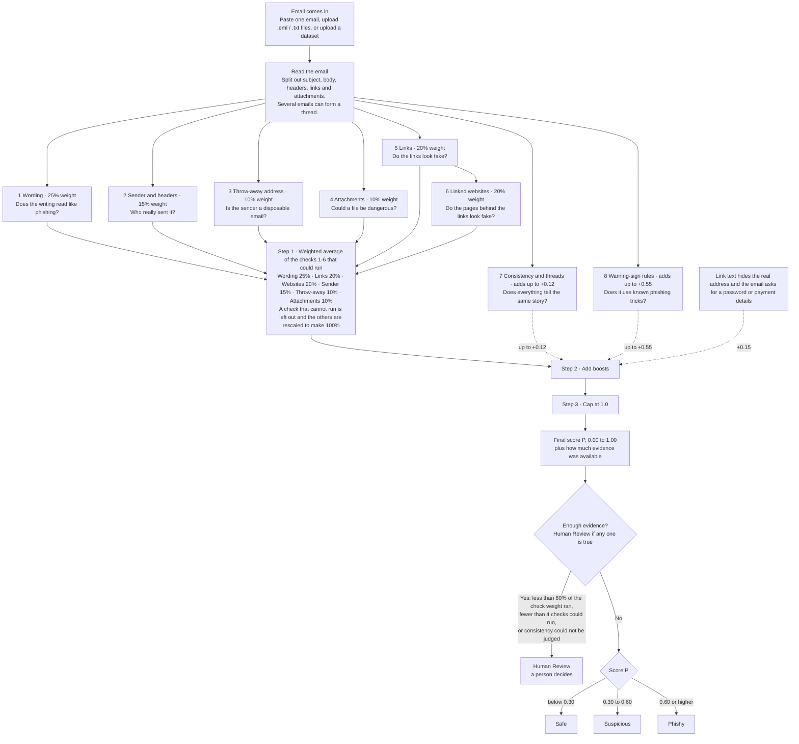

# VYOM phishing assessment flow

## Check details

| # | Check | Question | What it looks at | Contribution |
|---|-------|----------|------------------|--------------|
| 1 | Wording | Does the writing read like phishing? | Common phishing phrases, word-importance model, rare wording, pressure and "click here" phrases | 25% weight |
| 2 | Sender and headers | Who really sent it? | From vs Reply-To, missing or odd headers, login-check claims, fake display name, look-alike domain | 15% weight |
| 3 | Throw-away address | Is the sender a disposable email? | Known disposable domains (about 150), type of sender, how new the domain is, Reply-To address too | 10% weight |
| 4 | Attachments | Could a file be dangerous? | Risky file types, hidden double extensions like `invoice.pdf.exe`, name vs type mismatch; files are never opened | 10% weight |
| 5 | Links | Do the links look fake? | Odd length or structure, IP addresses, look-alike spelling, redirects, link text hiding the real address | 20% weight |
| 6 | Linked websites | Do the pages behind the links look fake? | Domain and its age, brand imitation and logo, urgent wording, password or payment forms | 20% weight |
| 7 | Consistency and threads | Does everything tell the same story? | Sender, wording, links and page about the same topic; earlier emails in the thread | adds up to +0.12 |
| 8 | Warning-sign rules | Does it use known phishing tricks? | Fake brand domains, mismatched Reply-To, hidden links, disposable sender, pressure language | adds up to +0.55 |

## Combining the scores

1. **Weighted average** of checks 1-6 that could run. A check that cannot run is left out and the remaining weights are rescaled to make 100%.
2. **Add boosts:**
   - Link text hides the real address and the email asks for a password or payment details: +0.15
   - Consistency and thread check: up to +0.12
   - Warning-sign rules: up to +0.55
3. **Cap at 1.0.**

## Verdicts

| Condition | Outcome |
|-----------|---------|
| Less than 60% of the check weight ran, fewer than 4 checks could run, or consistency could not be judged | Human Review |
| P below 0.30 | Safe |
| P 0.30 to below 0.60 | Suspicious |
| P 0.60 or higher | Phishy |

Scores are rough risk signals, not probabilities. Website retrieval fetches bounded static HTML only. Attachments are assessed from metadata and are never opened.
